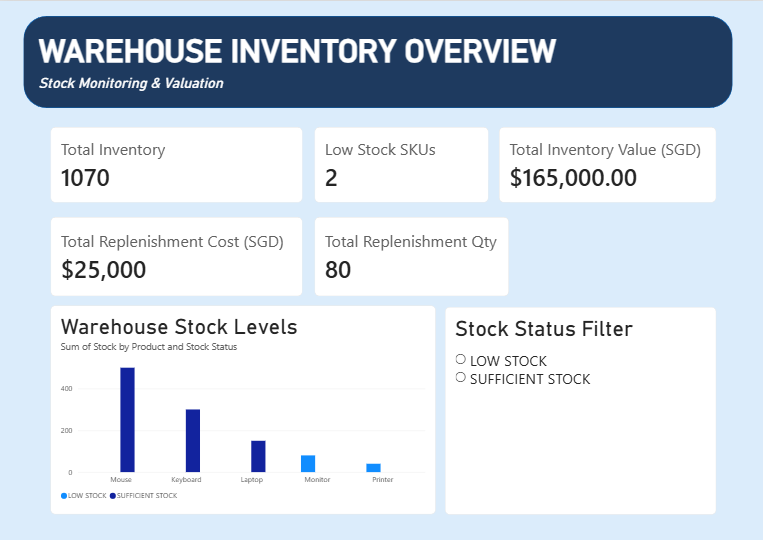
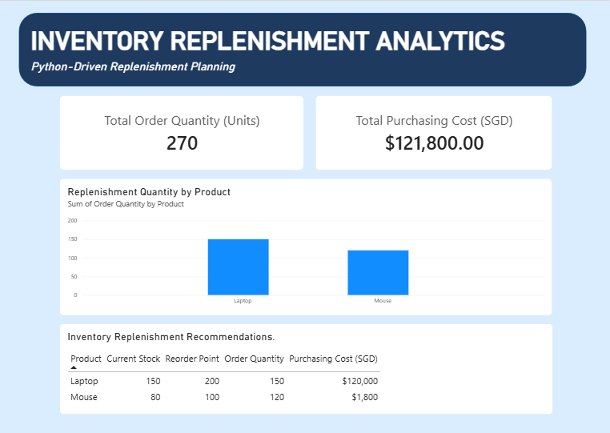

# warehouse-inventory-analytics
Python-based inventory monitoring and replenishment analytics with Power BI dashboards.
# Python-Driven Warehouse Inventory & Replenishment Analytics

A beginner-level independent project exploring how Python and Power BI can support inventory monitoring and replenishment planning in warehouse operations.

## Project Overview

This project was developed as part of my independent learning journey to explore digital tools used in supply chain management.

Using simulated warehouse inventory datasets, I developed Python scripts to monitor stock levels, identify replenishment requirements and calculate estimated purchasing costs. I then used Power BI to create dashboards that visualise the results.

## Business Problem

Poor inventory management can lead to excessive stockholding costs, limited warehouse storage space and inventory shortages.

Without sufficient safety stock, unexpected customer demand or supplier delivery delays may result in stockouts, order fulfilment disruptions and lost sales.

This project explores how inventory calculations and data visualisation can help support better replenishment decisions.

## Project Objectives

- Identify products with insufficient inventory.
- Apply predefined reorder points and target stock levels.
- Calculate replenishment quantities and purchasing costs.
- Visualise inventory information using Power BI.
- Develop foundational programming and data analytics skills.

## Tools Used

- **Python:** Inventory calculations and CSV data generation.
- **Power BI:** Interactive dashboards and data visualisation.
- **Power Query:** Data preparation.
- **CSV:** Storage and transfer of simulated inventory datasets.

## Methodology

1. Created simulated warehouse inventory datasets.
2. Developed Python scripts to evaluate stock levels and calculate replenishment requirements.
3. Exported processed inventory information to CSV.
4. Imported datasets into Power BI.
5. Created dashboard visualisations for inventory monitoring and replenishment planning.

## Dashboard 1: Warehouse Inventory Overview

This dashboard presents inventory levels, stock status and inventory valuation.

**Key Results:**

- Total inventory: 1,070 units
- Low-stock products: 2
- Total inventory value: S$165,000
- Replenishment quantity: 80 units
- Estimated replenishment cost: S$25,000

**Finding:** Monitor and Printer were identified as requiring replenishment.

## Dashboard 2: Inventory Replenishment Analytics

This dashboard presents the replenishment quantities and estimated purchasing expenditure for a separate simulated inventory scenario.

**Key Results:**

- Total replenishment quantity: 270 units
- Estimated purchasing cost: S$121,800
- Products requiring replenishment: Laptop and Mouse

**Finding:** Laptop replenishment accounts for most of the estimated purchasing cost.

**Note:** The two dashboards represent different simulated scenarios, so their replenishment totals should not be combined.

## Reflection and Future Improvements

Before starting this project, I had never used Python or Power BI. After researching the technical skills commonly used in supply chain management, I decided to familiarise myself with both tools through an inventory-related project.

One of the biggest challenges I faced was navigating the software and locating the functions I needed. However, completing the project helped me become more familiar with Python programming and data visualisation.

If I were to improve this project, I would focus on becoming more efficient and independent when using these tools. I would also like to explore real-world inventory data and demand forecasting in future projects.

## Project Limitations

This project uses simulated data and predefined replenishment thresholds. It does not include real-time inventory transactions, dynamic demand forecasting or supplier lead-time variability.

## Project Files

- `warehouse_inventory.py` — Warehouse inventory program
- `reorder_point.py` — Reorder point calculations
- `inventory_export.py` — Inventory data export
- `multi_product_reorder.py` — Multi-product replenishment calculations
- `inventory_report.csv` — Simulated inventory dataset
- `replenishment_report.csv` — Simulated replenishment dataset
- `screenshots/` — Power BI dashboard screenshots

---

**Project Type:** Independent Learning Project  
**Field:** Logistics & Supply Chain Management
